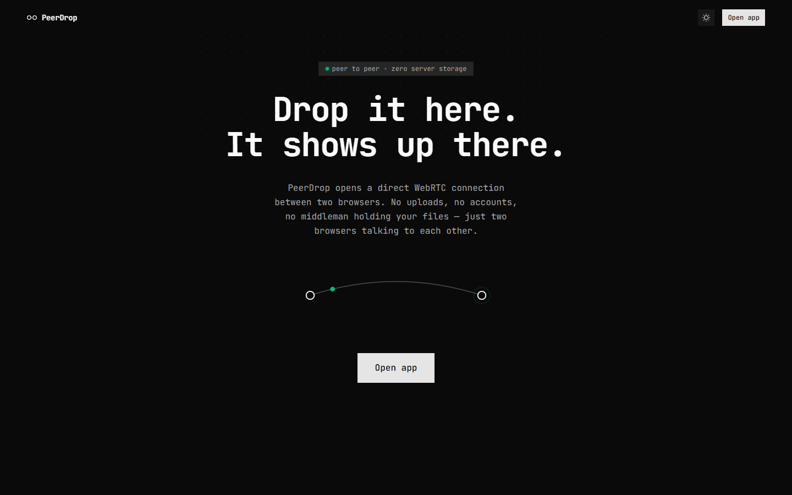
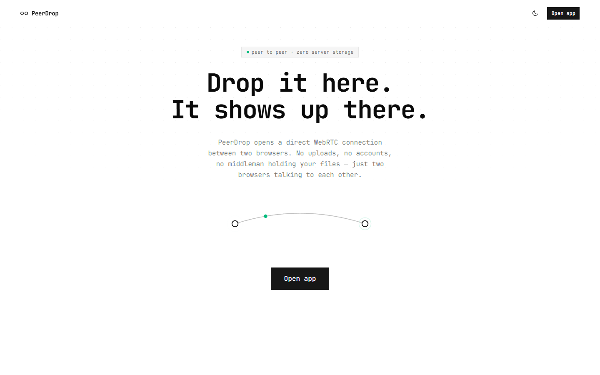
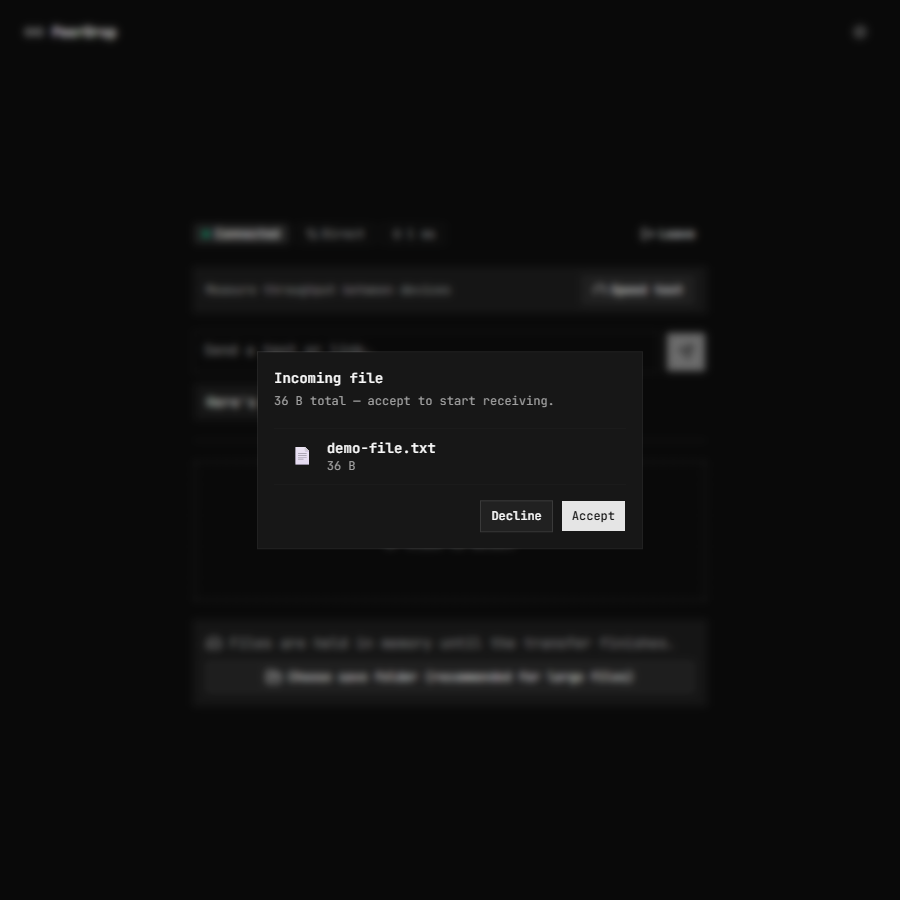
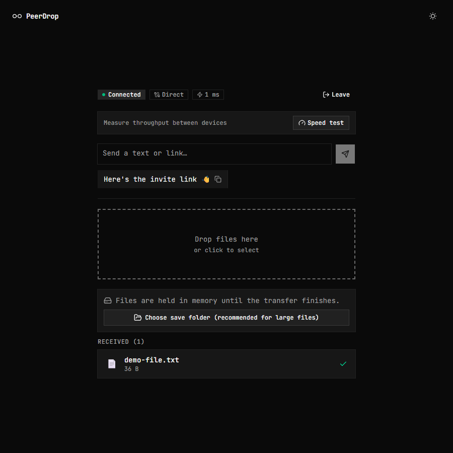
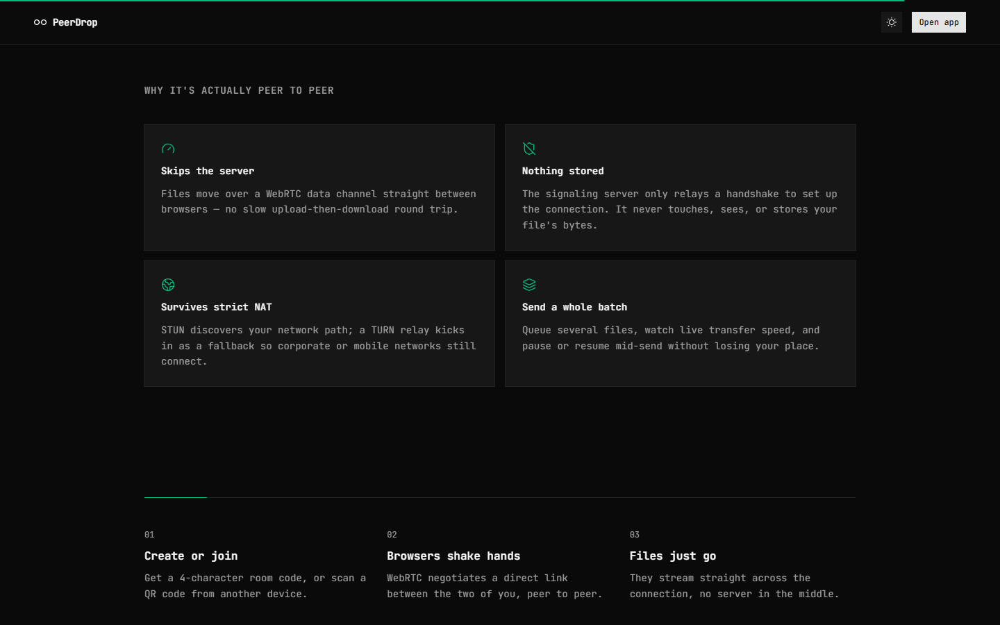

<div align="center">

# PeerDrop

**Drop it here. It shows up there.**

Send files, text, and links directly between browsers over an encrypted
peer-to-peer connection. No uploads, no accounts, no server ever touching
your data.

[**peerdrop.sshogunn.org →**](https://peerdrop.sshogunn.org/)


</div>

<p align="center">
  
  
</p>

---

## Why this exists

Most "share a file with someone" tools work the same way: your file goes up
to a server, sits there, and someone downloads it back down. That's a
round trip through infrastructure that has to store, and therefore *can*
leak, your data.

PeerDrop skips that step. Two browsers open a direct
[WebRTC](https://webrtc.org/) `RTCDataChannel` and the bytes move straight
from one to the other, encrypted end-to-end via DTLS. The only thing
touching a server is a four-character room code used to introduce the two
browsers to each other — after that handshake, the server is out of the
picture entirely.

## What makes it worth using

- **Actually peer-to-peer** — the signaling server relays only the WebRTC
  offer/answer/ICE handshake. It never sees, stores, or proxies file bytes.
- **Consent, not surprise** — the receiver gets an explicit *Accept /
  Decline* prompt before any transfer starts, with the file list and total
  size shown up front.
- **Bidirectional** — either side of a connected room can send files or
  text at any time, not just the person who created the room.
- **Integrity-verified** — every file is SHA‑256 hashed on the sender
  (via [`hash-wasm`](https://github.com/Daninet/hash-wasm)) while it's
  being read, and re-verified on the receiver before it's kept. A mismatch
  discards the file and tells both sides.
- **Streams to disk, not to RAM** — on browsers that support the File
  System Access API, incoming files are written straight to a chosen
  folder in constant memory, so a multi-gigabyte transfer doesn't crash
  the tab. Falls back to an in-memory download elsewhere.
- **Works across networks, not just the same LAN** — STUN handles the
  common case; a Cloudflare TURN relay (short-lived credentials minted
  server-side) kicks in automatically when direct connection fails, e.g.
  behind strict corporate NAT or on cellular. A **Direct / Relayed** badge
  tells you which one you got — right next to a live ping reading.
- **Built-in speed test** — measure real duplex throughput between the
  two connected devices with one click, no third-party service involved.
- **Instant text & links** — a lightweight clipboard-style channel for
  sharing a snippet or URL without wrapping it in a file, complete with
  auto-linkification.
- **Installable PWA, desktop app, or CLI** — use it in the browser, add it
  to your home screen, run the native Wails desktop build, or drive it
  from a terminal — all three speak the same protocol and can send/receive
  with each other interchangeably.
- **Resilient** — reconnects automatically on a dropped signaling socket
  or a failed ICE path, holds the screen awake during an active session,
  and recovers fast when you switch back to the tab.

## In action

<table>
<tr>
<td width="50%">

**Consent before anything transfers**



</td>
<td width="50%">

**A connected session — ping, speed test, chat, files**



</td>
</tr>
</table>

<p align="center">
  
</p>

## How it works

```
┌──────────┐   WebSocket (signaling only:   ┌──────────┐
│ Browser A│   room codes, SDP offer/answer, │ Browser B│
│          │◄────────── ICE candidates ─────►│          │
└────┬─────┘        via FastAPI server        └────┬─────┘
     │                                              │
     │            RTCDataChannel (DTLS-encrypted)   │
     └───────────── files · text · links ───────────┘
                  direct, or via TURN relay
```

1. One browser creates a room and gets back a 4-character code (+ QR).
2. The other browser joins with that code. The server relays the WebRTC
   handshake between them and then steps out.
3. A direct `RTCDataChannel` opens between the two browsers. Every file
   send now goes: request → the other side accepts/declines → chunked,
   hashed transfer → integrity check → done.

## Get PeerDrop

PeerDrop ships three ways — a browser app, a native desktop app, and a CLI
— all speaking the exact same protocol, so a terminal on a server can send
a file straight to someone's browser tab.

### Web app

Nothing to install — open **[peerdrop.sshogunn.org](https://peerdrop.sshogunn.org/)**.
Installable as a PWA (add to home screen) for an app-like, offline-capable
shell.

### Desktop (Windows / Linux)

A native [Wails](https://wails.io) build of the same UI. Download the
latest `desktop-v*` asset from the
**[Releases page](https://github.com/SSShogunn/peerdrop/releases)**.

> Builds aren't code-signed, so Windows SmartScreen will warn about an
> unknown publisher — click **More info → Run anyway**.

### CLI (Windows / Linux / macOS)

A Go binary for sending and receiving from a terminal — handy for servers,
scripts, or headless machines. Download the `cli-v*` asset for your
platform from the **[Releases page](https://github.com/SSShogunn/peerdrop/releases)**,
then:

```bash
chmod +x peerdrop-*        # Linux/macOS only
./peerdrop send file1.txt file2.png     # creates a room, prints a code
./peerdrop receive ABCD --out ./downloads   # joins a room, saves files there
```

`peerdrop receive -y` skips the accept prompt; `peerdrop --help` lists
every flag (chunk size, custom signaling/STUN servers, etc). Full details
in [`native/cli/README.md`](native/cli/README.md).

## Tech stack

| | |
|---|---|
| **Web client** | React 19 · TypeScript · Vite · Tailwind CSS v4 · shadcn/ui (Base UI) · Motion · anime.js · `hash-wasm` · `vite-plugin-pwa` |
| **Desktop** | [Wails](https://wails.io) (Go) wrapping the same React client |
| **CLI** | Go, sharing a `peerdrop-core` WebRTC/protocol module with the desktop app |
| **Server** | FastAPI · WebSockets · Uvicorn · Python 3.12 · [`uv`](https://docs.astral.sh/uv/) |
| **Transport** | WebRTC (`RTCDataChannel`), STUN, Cloudflare TURN (Realtime) |
| **Dev environment** | Docker Compose (Vite with hot reload + FastAPI) |
| **CI** | GitHub Actions (lint + typecheck + build, cross-platform CLI/desktop releases) |

## Project layout

```
peerdrop/
├── client/                  React + Vite web frontend (also embedded in desktop)
│   └── src/
│       ├── components/      UI (screens/, landing/, ui/ primitives, transfer widgets)
│       ├── context/         PeerContext — signaling + WebRTC + transfer state
│       ├── lib/              formatting/icon helpers
│       └── types/            shared protocol & UI types
├── server/                  FastAPI signaling server
│   └── main.py              rooms, relay, rate limiting, TURN credentials
├── native/
│   ├── peerdrop-core/       Go WebRTC + protocol module shared by cli/ and desktop/
│   ├── cli/                 terminal client (`peerdrop send` / `peerdrop receive`)
│   └── desktop/              Wails app embedding client/'s build output
├── docs/screenshots/         README assets
├── Dockerfile.backend        backend image
└── docker-compose.dev.yml    dev stack: Vite + backend
```

## Running it locally

Dev is unopinionated — run each side directly, no Docker needed.

**Server**
```bash
cd server
uv sync
uv run uvicorn main:app --reload
```

**Web client** (separate terminal)
```bash
cd client
pnpm install
cp .env.example .env   # point VITE_SIGNALING_SERVER at your local server
pnpm dev
```

Open two browser windows/tabs at the printed Vite URL — create a room in
one, join with the code in the other.

**CLI**
```bash
cd native/cli
go build -o peerdrop .
./peerdrop send some-file.txt
```

**Desktop**
```bash
cd native/desktop
wails dev
```

### Configuration

Both `server/` and `client/` read from a local `.env` (see
[`.env.example`](.env.example) and
[`client/.env.example`](client/.env.example)). Everything has a sane
default; the server only *needs* a `CF_TURN_KEY_ID`/`CF_TURN_API_TOKEN`
pair if you want a TURN relay fallback, and the client only needs
`VITE_SIGNALING_SERVER` pointed at your server.

## Docker dev stack

```bash
docker compose -f docker-compose.dev.yml up -d
```

Starts the backend on `:8000` and the Vite dev server on `:5173` with hot
reload. Vite proxies `/ws` and `/turn-credentials` to the backend, so the
client needs no `.env` to talk to it.

## Server API surface

The signaling server is deliberately small — it never sees file content.

| Endpoint | Purpose |
|---|---|
| `WS /ws` | Room create/join + WebRTC offer/answer/ICE relay |
| `GET /turn-credentials` | Mints short-lived Cloudflare TURN credentials |
| `GET /health` | Uptime, active rooms, connected peers |
| `GET /metrics` | Prometheus-format counters |

Rooms are TTL-swept, rate-limited per IP, and capped in count — see
[`.env.example`](.env.example) for the knobs.

## License

No license has been set yet for this repository — all rights reserved by
default until one is added.
